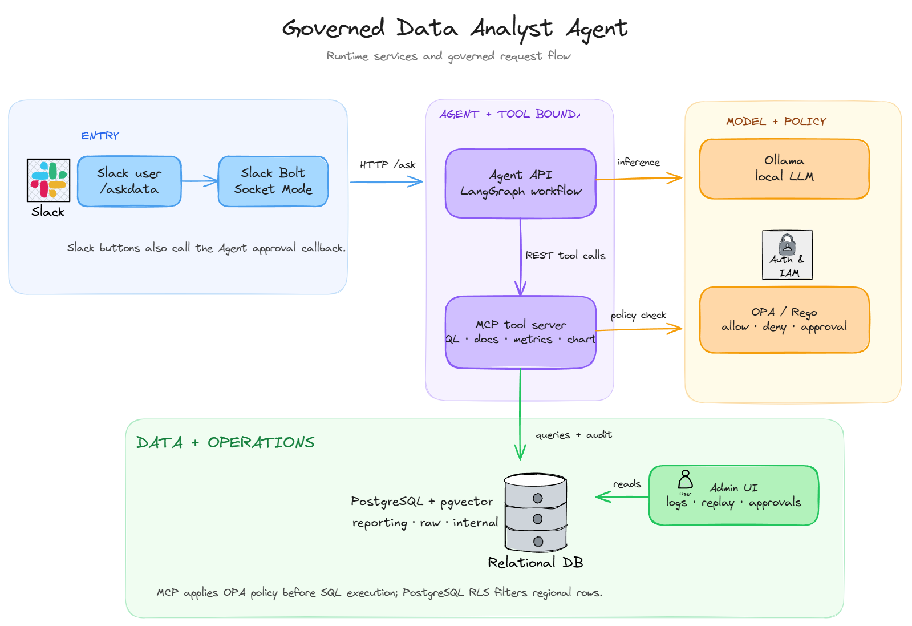

<h1 align="center">Governed Data Analyst Agent</h1>

<p align="center"><strong>Ask data questions in Slack. Get governed, explainable answers.</strong></p>

<p align="center">A reference implementation built with LangGraph, an MCP tool server, OPA, PostgreSQL, and Ollama.</p>

<p align="center">
  <a href="https://github.com/4ymaneBH/Governed-Data-Analyst-Agent-for-slack/actions/workflows/ci.yml"></a>
  
  
  
</p>

<p align="center"><a href="#quick-start">Quick start</a> · <a href="#architecture">Architecture</a> · <a href="#tech-stack">Tech stack</a> · <a href="#documentation">Documentation</a></p>

---

## Overview

Business users ask questions with `/askdata` in Slack. A LangGraph workflow retrieves context, plans a query with a local LLM, and calls governed tools for SQL, document search, metric definitions, and charts. The tool server checks OPA policy before execution and records audit data for review.

> **Example question:** `/askdata What was our customer acquisition cost last month?`

## Highlights

| Capability | How it works |
| --- | --- |
| Natural language analysis | Ollama helps classify questions, plan SQL, and compose answers. |
| Governed tools | The tool server implements SQL, document search, metric lookup, and chart tools; the agent currently calls its REST endpoints. |
| Policy checks | OPA evaluates role, table, column, and approval rules before tool execution. |
| Data boundaries | PostgreSQL contains reporting, raw, and internal schemas, with row-level security policies defined for regional data. |
| Evidence and replay | Tool decisions are logged, and the admin UI exposes audit and replay views. |
| Visual answers | Chart requests can produce rendered images for Slack responses. |

## Architecture



The deployment contains seven Docker Compose services: Slack app, agent, MCP tool server, OPA, Ollama, PostgreSQL, and admin UI.

1. **Slack entry:** `/askdata` reaches the Slack Bolt app, which adds a user role and region before calling the agent’s `POST /ask` endpoint.
2. **Agent workflow:** LangGraph classifies intent, retrieves context, plans SQL, invokes tools, validates results, and composes an answer. Ollama supplies local inference.
3. **Governed execution:** The agent calls the tool server’s REST `/api/*` endpoints. MCP handlers are defined, but the `/mcp` HTTP router is currently commented out. The server consults OPA before running a tool.
4. **Data and operations:** The tool server queries PostgreSQL, uses pgvector for document search, and writes audit records. The admin UI reads audit, replay, and approval data.

The image’s **Auth & IAM** symbol represents identity and role context in the flow; Docker Compose does not define a separate IAM service. See the [detailed architecture](docs/architecture.md) for the broader design.

> [!NOTE]
> OPA can return `REQUIRE_APPROVAL`, but the Slack admin-channel post is currently commented out. The callback updates an existing approval record and does not resume the query.

## Quick start

### Prerequisites

- Docker with Compose
- Git
- A Slack app with Socket Mode and `/askdata` configured; see the [setup guide](SETUP_GUIDE.md)

### Start the stack

```bash
git clone https://github.com/4ymaneBH/Governed-Data-Analyst-Agent-for-slack.git
cd Governed-Data-Analyst-Agent-for-slack
cp .env.example .env
```

Set `SLACK_BOT_TOKEN`, `SLACK_SIGNING_SECRET`, and `SLACK_APP_TOKEN` in `.env`, then start the services:

```bash
docker compose -f infra/docker-compose.yml up -d --build
docker exec analyst-ollama ollama pull llama3.2
docker exec analyst-ollama ollama pull nomic-embed-text
```

The Compose file requests an NVIDIA GPU for Ollama. If your machine has no NVIDIA GPU, remove the `deploy.resources.reservations.devices` block from the Ollama service before starting the stack.

| Service | Local address |
| --- | --- |
| Admin dashboard | [localhost:8080](http://localhost:8080) |
| Agent API docs | [localhost:8002/docs](http://localhost:8002/docs) |
| MCP tool server | [localhost:8001/tools](http://localhost:8001/tools) |
| OPA health | [localhost:8181/health](http://localhost:8181/health) |

Once the Slack app is configured, try `/askdata Show me the top 5 customers by revenue`. For a Windows setup without Docker, see [Run Locally](RUN_LOCALLY.md).

## Tech stack

[](https://www.python.org/)
[](https://fastapi.tiangolo.com/)
[](https://www.langchain.com/langgraph)
[](https://ollama.com/)
[](https://www.postgresql.org/)
[](https://www.docker.com/)

**Interface:** Slack Bolt · **Tool integration:** REST endpoints and defined MCP handlers · **Policy engine:** OPA/Rego · **Vector search:** pgvector · **Charts:** Altair

## Security and governance

| Control | Implementation |
| --- | --- |
| Role and tool access | [RBAC rules](policies/rego/rbac.rego) in OPA |
| Schema and table access | [Table rules](policies/rego/tables.rego) in OPA |
| Sensitive columns | [Column rules](policies/rego/columns.rego) and result masking |
| Regional data | [Row policies](infra/postgres/init.sql) in PostgreSQL |
| Approval decisions | [Approval rules](policies/rego/approval.rego); request delivery and resumption remain incomplete |
| Audit and replay | Records in `internal.audit_logs`, surfaced by the admin UI |

Role mapping in the Slack service is currently defined in code. Review the [threat model](docs/threat-model.md) before adapting this reference implementation for real data.

## Evaluation

The repository includes [50 evaluation questions](eval/questions.jsonl) and unit tests. With the agent running, execute:

```bash
python -m pip install httpx
python eval/runner.py
```

The runner writes `eval/report.md`. CI also runs Python checks, policy tests, and Docker builds; its integration test job is currently a placeholder.

## Project layout

| Path | Purpose |
| --- | --- |
| [`services/slack_app/`](services/slack_app/) | Slack command and interactive handlers |
| [`services/agent/`](services/agent/) | FastAPI and LangGraph workflow |
| [`services/mcp_server/`](services/mcp_server/) | Governed tools, OPA client, and auditing |
| [`apps/admin-ui/`](apps/admin-ui/) | Audit, replay, policy, and approval views |
| [`policies/rego/`](policies/rego/) | OPA policy definitions and tests |
| [`infra/`](infra/) | Docker Compose and PostgreSQL setup |
| [`eval/`](eval/) | Evaluation questions and runner |

## Documentation

- [Setup and deployment guide](SETUP_GUIDE.md)
- [Run locally on Windows](RUN_LOCALLY.md)
- [Architecture details](docs/architecture.md)
- [Threat model](docs/threat-model.md)
- [Data dictionary](data/docs/data_dictionary.md) · [Metric definitions](data/docs/metric_definitions.md) · [Business glossary](data/docs/business_glossary.md)

## Contributing

Issues and pull requests are welcome. Include a focused test when changing policy behavior or tool execution, and describe any impact on access control.

## License

No license file is currently included in this repository.
